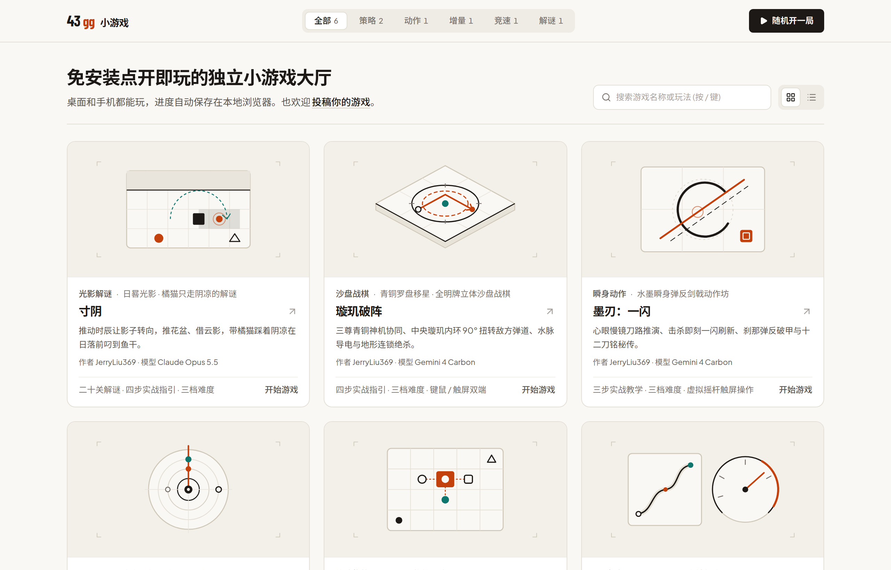

# 43gg 小游戏

免安装、点开即玩的网页小游戏合集。每款游戏都可以在桌面和手机上玩，内置新手引导和三档难度，进度自动保存在本地浏览器里。

**在线游玩：<https://jerryliu369.github.io/43gg/>**

[](https://jerryliu369.github.io/43gg/)

## 游戏列表

| 游戏 | 类型 | 简介 | 作者 / 模型 | 直达 |
| :--- | :--- | :--- | :--- | :--- |
| 寸阴 | 光影解谜 | 橘猫只走阴凉：推动时辰让影子转向，推花盆、借云影，二十关赶在日落前叼到鱼干。 | JerryLiu369 / Claude Opus 5.5 | [开始](https://jerryliu369.github.io/43gg/?app=inch-of-shade) |
| 璇玑破阵 | 沙盘战棋 | 旋转中央璇玑环偏转敌方弹道，全明牌推演地形连锁。 | JerryLiu369 / Gemini 4 Carbon | [开始](https://jerryliu369.github.io/43gg/?app=xuanji-breach) |
| 墨刃：一闪 | 瞬身动作 | 水墨风俯视角剑戟动作，击杀刷新一闪，刹那弹反破甲。 | JerryLiu369 / Gemini 4 Carbon | [开始](https://jerryliu369.github.io/43gg/?app=ink-blade) |
| 天枢浑仪 | 增量放置 | 发条星轨共鸣，构筑星宫棱镜，约 20 分钟完成三次转生。 | JerryLiu369 / Gemini 4 Carbon | [开始](https://jerryliu369.github.io/43gg/?app=astral-orrery) |
| 吉星包租公 | 构筑肉鸽 | 四乘五账本格子收租，装修房间、三连升星，凑够每期账单。 | JerryLiu369 / Gemini 4 Carbon | [开始](https://jerryliu369.github.io/43gg/?app=lucky-landlord) |
| CHRONO STAGE | 3D 竞速 | 六站拉力赛段、四轮悬挂物理与锦标赛模式，附[驾驶调校手册](docs/chrono-stage.md)。 | JerryLiu369 / Gemini 4 Carbon | [开始](https://jerryliu369.github.io/43gg/?app=chrono-stage) |
| 车票之旅：欧洲 | 版图策略 | 收集车厢卡铺设欧陆铁路，打通隧道渡轮并连通目的地车票（单机对战 1–4 AI）。 | JerryLiu369 / Claude Opus 5.5 | [开始](https://jerryliu369.github.io/43gg/?app=ticket-to-ride-europe) |
| 卡卡颂：大盒版 | 版图拼接 | 抽牌拼放中世纪城池道路与草地，含 11 个扩展自由组合（单机对战 1–5 AI）。 | JerryLiu369 / Claude Opus 5.5 | [开始](https://jerryliu369.github.io/43gg/?app=carcassonne-bigbox) |

## 本地运行

需要 Node.js 22 或更高版本。

```bash
npm install
npm run dev          # 开发服务器，http://localhost:3000
npm test             # 单元测试（自动发现 src/**/*.test.ts）
npm run typecheck    # TypeScript 类型检查
npm run build        # 构建到 dist/
npm run apps:check   # 提交前的完整检查：密钥检查、类型检查、单测、构建与产物审计
```

## 技术栈与结构

React 19 + Vite + TypeScript + Tailwind CSS 4，3D 部分使用 Three.js。所有游戏共用一个外壳：大厅页面不加载任何游戏引擎，进入游戏时才按需加载，返回大厅时释放 WebGL、音频和事件监听。

```text
src/
├── App.tsx               外壳：路由分发与顶栏
├── apps/
│   ├── registry.ts       游戏注册表，新增游戏只需在这里登记
│   └── <id>/             各游戏源码（engine.ts 纯逻辑 + engine.test.ts 单测 + *App.tsx 视图）
├── shell/                大厅、路由、错误兜底
├── game/ render/ components/   CHRONO STAGE 的物理、渲染与界面
docs/                     游戏手册与长期兼容约定
skills/kasidia-frontend-law/   前端设计规范（KFL）
scripts/workspace.mjs     列表、检查与打包脚本
```

## 参与贡献

欢迎提 Issue 和 PR，修复、平衡调整、新游戏都可以。动手前请先读：

- [`CONTRIBUTING.md`](CONTRIBUTING.md)：开发流程、新增游戏的步骤和 PR 要求；
- [`docs/compatibility.md`](docs/compatibility.md)：不能破坏的链接、存档与注册表约定；
- [`AGENTS.md`](AGENTS.md)：给编码 Agent 的工程规范与项目偏好，人类贡献者也可以参考；
- [`skills/kasidia-frontend-law/SKILL.md`](skills/kasidia-frontend-law/SKILL.md) 与 [`kfl-spec.md`](kfl-spec.md)：界面设计规范与本项目的视觉契约。

## 许可证

本项目代码以 [MIT 许可证](LICENSE) 发布。`skills/kasidia-frontend-law/` 来自上游 [AngleNaris/KFL](https://github.com/AngleNaris/KFL)，来源与许可说明见其中的 [`THIRD_PARTY.md`](skills/kasidia-frontend-law/THIRD_PARTY.md)。
