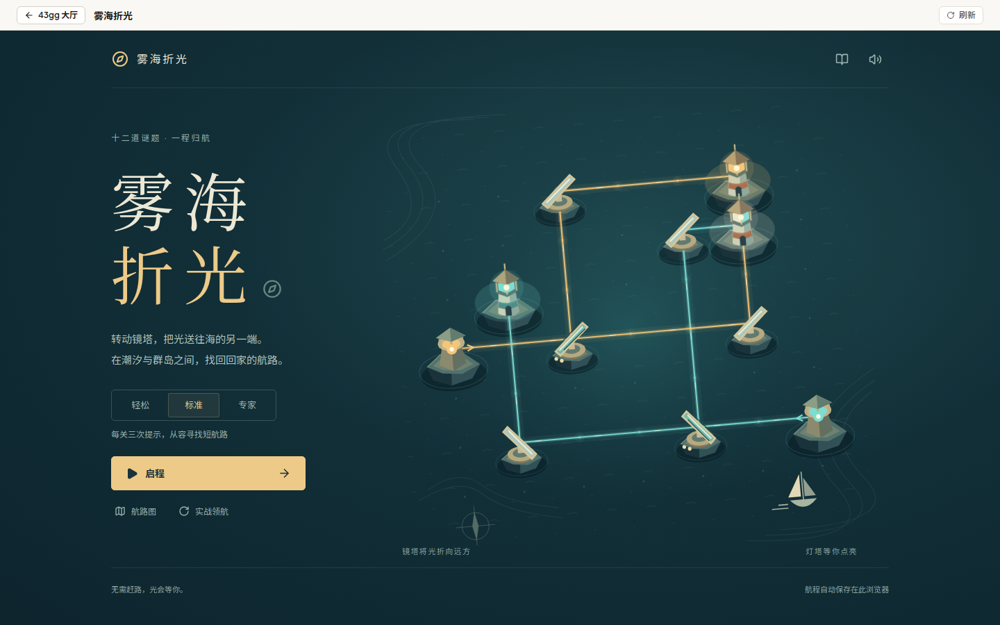
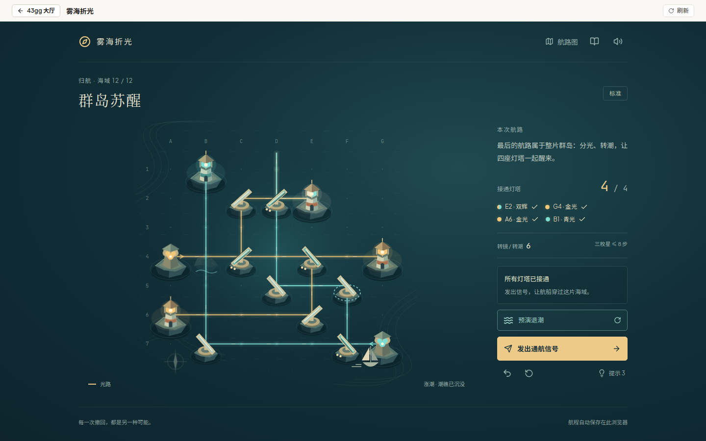
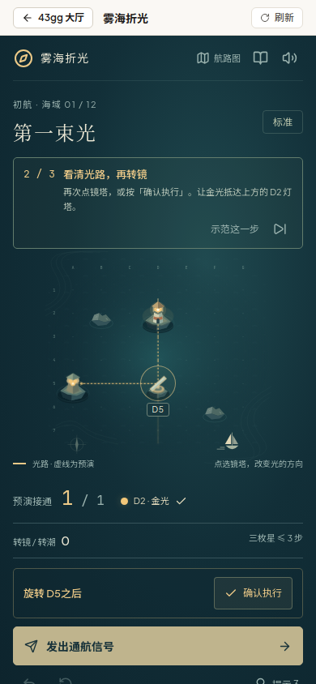

# 雾海折光

在微缩海岛间旋转镜塔，把金光与青光送到对应灯塔；全部接通后发出通航信号，解锁下一片海域。十二关分为「初航」「潮间」「归航」三章，没有倒计时或失败扣分。

## 镜塔与潮汐

| 机关 | 作用 |
| :--- | :--- |
| 镜塔 | 在两种镜面朝向间切换，将光转向九十度。 |
| 分光塔 | 保留直行光，同时反射另一束光。双层镜面与基座的双圆标识用于辨认。 |
| 潮镜 | 带虚线圆环，随潮汐统一翻转，不能单独旋转。 |
| 潮礁 | 退潮时挡光，涨潮后沉没，可以透光。普通礁石始终挡光。 |
| 灯塔 | 金色接收金光，青色接收青光；双色灯塔需要两色同时抵达。光抵达灯塔或发光塔后终止。 |

不同颜色的光可以交叉穿行。所有目标必须同时接通，先后点亮不算完成。

## 操作

- **鼠标**：悬停镜塔查看整盘预演，点击旋转。
- **触屏**：首点锁定预演，再点同一座镜塔，或按「确认执行」。
- **键盘**：Tab 聚焦镜塔，回车旋转；Z 撤回，T 预演潮汐，Esc 取消预演或关闭手册。
- **潮汐**：点击「预演涨潮 / 退潮」，查看所有潮镜与光路变化后确认。
- **领航**：首次启程进入三步实战引导，可跳过、逐步示范；标题页「实战领航」或手册中的重温按钮可重新练习第一关。重温保留已获得的关卡记录。

## 难度与星级

| 难度 | 三枚星步数上限 | 每关提示 |
| :--- | :--- | :--- |
| 轻松 | 最少步数 + 4 | 不限次 |
| 标准 | 最少步数 + 2 | 3 次 |
| 专家 | 最少步数 | 不提供 |

旋转镜塔、切换潮汐各计一步。撤回恢复上一步的朝向、潮汐与步数；重新开始本关重置步数与提示。提示会从当前盘面求最近解，只展示建议和预演，仍需玩家确认。使用提示后本关最高两枚星；超过三枚星上限四步以内为两枚星，其余通关为一枚星。各关保留最高星级，同星级保留较少步数。

## 存档

当前盘面、最近两百步撤回历史、通关星级、难度、声音及教学偏好保存在当前浏览器的 `43gg.mistlight_voyage.progress.v1`。刷新或返回大厅后可以继续航程；存储不可用时仍可游玩，页脚会提示无法保存。

## 实测范围

2026-11-13 使用无头 Chromium 验证了桌面 `1440×900` 的十二关完整操作通关、平板 `768×1024`、手机 `390×844` 的真实触屏双阶段确认及密集终章，并检查教学、撤回、提示、恢复、模态焦点、减弱动态和退出时音频释放。正式构建在 `/43gg/` 子路径完成首关；移动端内容较长时使用纵向滚动。未执行实体手机与 Safari 测试。

